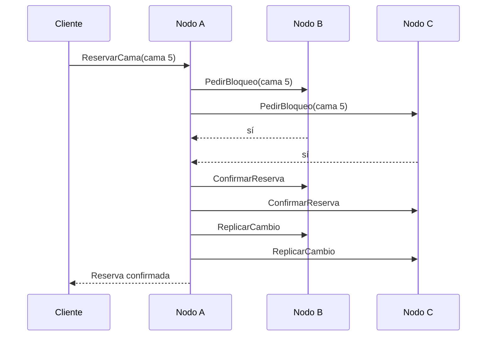

# Mini-RUBI: Diseño y Arquitectura de un Sistema Distribuido Básico

**Curso:** Sistemas Distribuidos 2026-3
**Estado:** Borrador de diseño (solo arquitectura, sin implementación)

---

## 1. Objetivo y alcance

Construir desde cero una versión reducida de **RUBI (Red Urgente de Bogotá Interconectada)** que demuestre los conceptos centrales de un sistema distribuido con arquitectura cliente-servidor.

**Incluido en este prototipo**
- Reserva de camas sin doble asignación.
- Replicación de datos entre nodos.
- Cliente y servidor en lenguajes distintos, comunicándose sin problema.

**Fuera de alcance** (quedan como trabajo futuro)
- Coordinación de ambulancias, módulos de medicamentos y especialistas.
- Integración con sistemas HIS reales (HL7/FHIR).
- Cifrado en reposo, auditoría y autenticación por roles.

---

## 2. Decisiones de diseño

| Tema | Decisión |
|---|---|
| Estilo de arquitectura | Cliente-servidor con servidores pares (sin nodo central) |
| Comunicación | gRPC con Protocol Buffers |
| Servidores (nodos hospital) | Python |
| Cliente | JavaScript / Node.js |
| Coordinación entre nodos | Nodos iguales; reserva por mayoría (2 de 3) |
| Datos | Base de datos local por nodo, con replicación entre nodos |

---

## 3. Arquitectura general

```mermaid
flowchart LR
    C["Cliente<br/>(Node.js)"]
    subgraph Red de nodos hospital (Python)
        A["Nodo A<br/>gRPC + BD local"]
        B["Nodo B<br/>gRPC + BD local"]
        D["Nodo C<br/>gRPC + BD local"]
    end
    C -- gRPC --> A
    C -. gRPC .-> B
    C -. gRPC .-> D
    A <--> B
    B <--> D
    A <--> D
```

- El cliente puede conectarse a **cualquier** nodo.
- Los nodos también se comunican entre sí por gRPC, para coordinar bloqueos y replicar cambios.
- No existe un servidor central: si un nodo cae, los otros siguen operando.

---

## 4. Componentes

### 4.1 Nodo hospital (servidor, Python)
- Servidor gRPC que atiende al cliente y a los demás nodos.
- Base de datos local (por ejemplo, SQLite) con sus propias camas y las réplicas de las demás.
- Módulo de **bloqueos**: controla qué camas están bloqueadas y por quién.
- Módulo de **replicación**: envía y recibe cambios.
- Lista de nodos pares (configuración).

### 4.2 Cliente (Node.js)
- Aplicación de consola (o web simple) que consulta y reserva camas.
- Si el nodo elegido no responde, prueba con otro.

### 4.3 Contrato común (`rubi.proto`)
Archivo único que define las operaciones y los mensajes. De él se genera el código en Python y en Node.js, lo que garantiza que ambos lados se entiendan.

---

## 5. Contrato gRPC (borrador)

```proto
syntax = "proto3";
package rubi;

service NodoRubi {
  // Cliente -> nodo
  rpc ConsultarCamas (ConsultaRequest) returns (ListaCamas);
  rpc ReservarCama   (ReservaRequest)  returns (ReservaResponse);

  // Nodo -> nodo
  rpc PedirBloqueo    (BloqueoRequest)   returns (BloqueoResponse);
  rpc ConfirmarReserva(ConfirmarRequest) returns (ConfirmarResponse);
  rpc LiberarBloqueo  (LiberarRequest)   returns (LiberarResponse);
  rpc ReplicarCambio  (CambioRequest)    returns (CambioResponse);
  rpc Sincronizar     (SyncRequest)      returns (ListaCamas);
}

message Cama {
  string id = 1;
  string hospital = 2;
  string tipo = 3;        // "UCI" o "GENERAL"
  string estado = 4;      // "LIBRE" o "RESERVADA"
  int64  version = 5;     // aumenta con cada cambio
}
```

*(Los demás mensajes se definen en la fase de implementación.)*

---

## 6. Flujo de reserva (por mayoría)

1. El cliente envía `ReservarCama(cama 5)` al nodo A.
2. A verifica que la cama esté libre y la bloquea localmente.
3. A llama `PedirBloqueo(cama 5)` a B y a C.
4. Cada nodo responde **sí** si la cama está libre y sin bloqueo de otro; **no** en caso contrario.
5. Si A obtiene al menos **2 de 3** votos (contando el suyo):
   - envía `ConfirmarReserva`,
   - marca la cama como `RESERVADA` y sube su `version`,
   - replica el cambio a los demás (`ReplicarCambio`).
6. Si no obtiene mayoría, llama `LiberarBloqueo` y responde al cliente que la cama no está disponible.



---

## 7. Concurrencia (evitar doble asignación)

- Cada nodo mantiene un **bloqueo por cama**.
- Si dos nodos piden la misma cama a la vez, cada nodo vota por el primero que le llegó y rechaza al segundo. Así, solo uno consigue la mayoría.
- Los bloqueos tienen **tiempo límite** (por ejemplo, 5 segundos) para que un bloqueo no quede atascado si el nodo que lo pidió se cae.

---

## 8. Replicación

- Cada cambio de cama incrementa su campo `version`.
- Tras una reserva confirmada, el nodo envía el cambio a los demás.
- Si un nodo estaba caído, al volver llama `Sincronizar` y recupera los cambios con `version` mayor a la que tiene.

---

## 9. Tolerancia a fallos

| Situación | Comportamiento |
|---|---|
| Cae 1 de 3 nodos | Los otros 2 mantienen la mayoría y siguen reservando |
| Caen 2 de 3 nodos | No hay mayoría: se rechazan reservas nuevas, pero se pueden consultar camas |
| Un nodo vuelve a conectarse | Se sincroniza con `Sincronizar` |
| El nodo del cliente no responde | El cliente intenta con otro nodo |

---

## 10. Heterogeneidad (lenguajes distintos)

- Los nodos están en **Python** y el cliente en **Node.js**.
- Ambos usan el mismo `rubi.proto`, por lo que los mensajes se entienden sin importar el lenguaje.
- Esto representa el principio de **heterogeneidad** y **apertura** de RUBI: un nuevo participante solo necesita respetar el contrato.

---

## 11. Principios de sistemas distribuidos demostrados

| Principio | Cómo se refleja en el prototipo |
|---|---|
| Heterogeneidad | Python y Node.js se comunican vía gRPC |
| Apertura | Contrato público `.proto`; se pueden añadir nodos o clientes |
| Concurrencia | Bloqueos por cama y votación por mayoría |
| Tolerancia a fallos | El sistema sigue operando con 1 nodo caído |
| Transparencia de ubicación | El cliente no necesita saber en qué nodo está cada dato |
| Transparencia de replicación | El cliente ve una sola vista de las camas |
| Transparencia de fallos | Si un nodo falla, el cliente cambia a otro sin intervención del usuario |
| Escalabilidad (básica) | Se pueden añadir más nodos modificando la lista de pares |

---

## 12. Limitaciones y trabajo futuro

- No se implementa un algoritmo de consenso completo (Raft/Paxos); la votación por mayoría es una versión simplificada.
- Pueden darse particiones de red que el prototipo no resuelve del todo.
- Seguridad (TLS, roles, auditoría conforme a la Ley 1581 de 2012) queda como mejora futura.
- Posible extensión: ambulancias, traslados y estándar HL7/FHIR.

---

## 13. Pendientes por definir

- [ ] Cantidad de camas por hospital y tipos (UCI, general).
- [ ] Formato del cliente: consola o web.
- [ ] Cómo se inician y configuran los nodos (puertos, lista de pares).
- [ ] Escenarios de demostración (por ejemplo: reserva simultánea, caída de un nodo).
